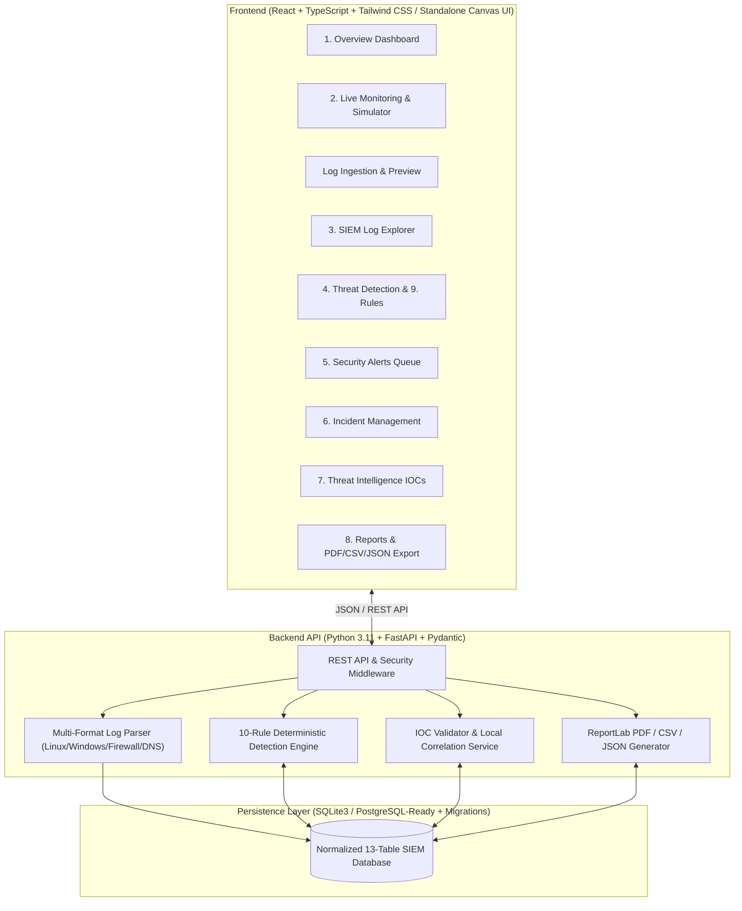
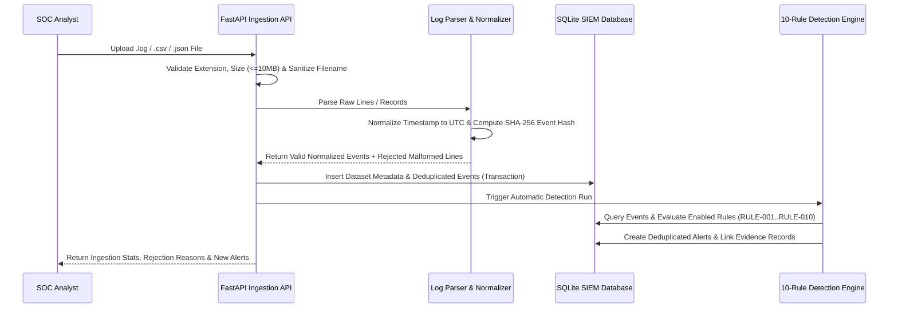
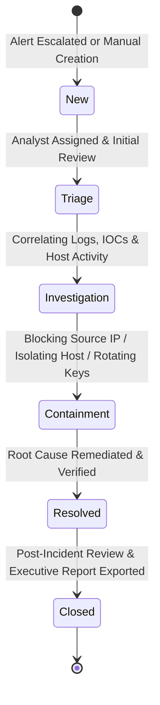

# SENTINEL SOC — Mini SOC Log Analyzer & Threat Detection Platform

> **Category:** Cybersecurity / Security Operations / Blue Team  
> **Designed and Developed by:** **Wasif Karim**  
> **Academic Affiliation:** DU PMICS — 7th Batch | B.Sc. in Computer Science & Engineering, Daffodil International University  
> **Contact:** [wasifkarim.work@gmail.com](mailto:wasifkarim.work@gmail.com) | [WhatsApp: +8801783734911](https://wa.me/8801783734911)

## 1. Project Overview & Description

**SENTINEL SOC** is a full-stack Security Information and Event Management (SIEM) and Security Operations Center (SOC) threat detection platform engineered to model the practical daily workflow of Tier-1 and Tier-2 SOC analysts.

It ingests multi-format security logs (Linux OpenSSH/sudo syslog, Windows Security Event CSV/JSON exports, Firewall connection logs, DNS resolver telemetry, and structured application logs), normalizes every event into a canonical schema with SHA-256 deduplication, evaluates events through a deterministic 10-rule MITRE ATT&CK-mapped Threat Detection Engine, and provides end-to-end Alert Triage, Case/Incident Management, Threat Intelligence IOC Enrichment, Live Synthetic Telemetry Simulation, and Branded PDF/CSV/JSON Executive Reporting.

## 2. Project Objectives

1. **Demonstrate Practical Blue-Team Engineering:** Implement the complete operational chain from raw log ingestion to incident closure and executive PDF reporting.
2. **Strict Data Provenance & Honesty:** Clearly distinguish between real user-uploaded log files (`uploaded`), curated sample datasets (`sample`), and synthetic live stream events (`simulated`). Never misrepresent simulated events as live packet capture or fabricate external threat intelligence reputation scores.
3. **Deterministic, Testable Detection:** Provide 10 configurable, MITRE ATT&CK-referenced detection rules that execute deterministically in UTC without relying on external AI APIs.
4. **Application Security First:** Enforce parameterized SQL queries, filename sanitization, path traversal protection, file size limits, RFC 5737/1918/2606 IOC validation, security headers, and comprehensive audit logging.

## 3. Key Features

- **Executive SOC Overview Dashboard:** 8 real-time database-backed KPI cards, interactive Event Volume Timeline, Alert Severity Donut Chart, Top Suspicious Source IPs, Event Category Distribution, Recent Security Alerts queue, and SOC Audit Trail.
- **Multi-Format Log Ingestion Pipeline:** Upload `.log`, `.txt`, `.csv`, and `.json` files (up to 10 MB), preview normalized records and rejected malformed lines before import, inspect SHA-256 dataset checksums, and remove datasets with confirmation.
- **SIEM Log Explorer:** Parameterized search across raw messages, `source_ip`, `destination_ip`, `username`, `hostname`, `event_type`, `source`, `event_id`, and `severity`, plus structured query syntax (`source_ip = "192.0.2.55" event_type = "authentication_failure"`), pagination, JSON event inspector, and CSV/JSON export.
- **10-Rule Threat Detection Engine:** Deterministic correlation across SSH brute-force, account lockout risk, password spraying, suspicious login after failures, privileged account escalation (`sudo` / Event ID `4672` / `4688`), off-hours logins (`00:00–05:00 UTC`), multi-event IP concentration, firewall port scans, high-entropy DNS tunneling, and HTTP burst flooding.
- **Security Alert Management:** Triage statuses (`New`, `Acknowledged`, `Investigating`, `Escalated`, `Resolved`, `False Positive`), analyst assignment, timestamped investigation notes, correlated log evidence, and one-click escalation to Incidents.
- **Incident Management System:** Full lifecycle workflow (`New → Triage → Investigation → Containment → Resolved → Closed`), chronological investigation timeline, linked alerts, IOC attachment, and resolution documentation.
- **Threat Intelligence IOC Workbench:** Validates IPv4, Domain (FQDN), MD5, SHA-1, and SHA-256 indicators; correlates against local sightings/alerts; identifies RFC 5737 documentation IPs and RFC 1918 private IPs; and reports honest offline/online external intelligence status.
- **Live Monitoring & Synthetic Simulator:** Real-time feed with pause/resume controls, severity/origin filters, and a clearly labeled `SIMULATION MODE` synthetic telemetry generator.
- **Branded Reports & Analytics:** Generate and download PDF, CSV, and JSON reports containing SENTINEL SOC branding, summary statistics, top suspicious IPs, findings, remediation recommendations, and Wasif Karim developer credit.

## 4. System Architecture & Workflows

### System Architecture



### Log Processing & Normalization Workflow



### Detection, Alert Triage & Incident Lifecycle Workflow



## 5. Detection Rule Documentation (RULE-001 to RULE-010)

| Rule ID | Rule Name | Default Severity | MITRE ATT&CK Mapping | Default Threshold / Window | Detection Summary |
| :--- | :--- | :--- | :--- | :--- | :--- |
| `RULE-001` | SSH Brute-Force Detection | High | `T1110.001` — Password Guessing | 5 failures / 300s | Repeated failed SSH logins from the same source IP in Linux auth logs. |
| `RULE-002` | Multiple Failed Login Attempts | Medium | `T1110.001` — Password Guessing | 4 failures / 300s | Repeated authentication failures targeting a single username across Linux or Windows (`4625`). |
| `RULE-003` | Password Spraying Indicator | High | `T1110.003` — Password Spraying | 4 distinct users / 600s | Single source IP failing authentication against multiple distinct usernames (labeled as an indicator requiring analyst verification). |
| `RULE-004` | Suspicious Successful Login | Critical | `T1078` / `T1110` — Valid Accounts | 3 failures + 1 success / 600s | Successful login immediately following repeated authentication failures from the same IP. |
| `RULE-005` | Privileged Account Activity | Critical | `T1548.003` / `T1059.001` | 1 event / 300s | Windows Event ID `4672` (Special Privileges), `4688` (Encoded PowerShell), or sensitive `sudo` command (`/etc/shadow`). |
| `RULE-006` | Unusual Login Time | Low | `T1078` — Valid Accounts | 1 event (00:00–05:00 UTC) | Off-hours authentication activity (explicitly notes timing alone does not prove malicious activity). |
| `RULE-007` | Suspicious IP Activity | Medium | `T1595` — Active Scanning | 6 events / 900s | High concentration of security events originating from a single source IP. |
| `RULE-008` | Port Scan Indicators | Medium | `T1046` — Network Service Discovery | 5 distinct TCP ports / 120s | Single source IP probing multiple destination ports in firewall logs (never triggered from auth logs alone). |
| `RULE-009` | Suspicious DNS Activity | High | `T1071.004` — DNS Protocol | 3 queries / 300s | High-entropy long subdomains (>=24 chars) or C2 tunneling patterns in DNS resolver logs. |
| `RULE-010` | Event Flooding / Log Anomaly | Medium | `T1499` — Endpoint DoS | 8 burst events / 60s | Rapid high-frequency HTTP burst or log flooding from a single source IP. |

## 6. Database Design

SENTINEL SOC uses a normalized 13-table relational schema stored in SQLite by default (`backend/data/sentinel_soc.db`) with SQLAlchemy declarative models and Alembic migration support for seamless PostgreSQL deployment:

1. `schema_migrations` — Tracks applied schema versions.
2. `log_sources` — Registered telemetry sources (`linux_auth`, `windows_security`, `firewall`, `dns_resolver`, `app_gateway`).
3. `imported_datasets` — Metadata, SHA-256 file checksums, origin tags (`uploaded`, `sample`, `simulated`), imported counts, and rejected line diagnostics.
4. `events` — Normalized security events indexed on `timestamp`, `source_ip`, `username`, `event_type`, `severity`, and `dataset_id`.
5. `detection_rules` — Configurable rule definitions, thresholds, time windows, and MITRE mappings.
6. `alerts` — Generated security alerts with `dedup_key` uniqueness to prevent duplicate alerts for the same incident window.
7. `alert_evidence` — Foreign-key join linking each alert to its underlying `events` records.
8. `incidents` — SOC case files tracking lifecycle status, assignee, linked alerts, and resolution summary.
9. `incident_notes` — Chronological investigation timeline entries per incident.
10. `ioc_records` — Investigated IPv4, domain, and hash indicators with local sighting counts and external status notes.
11. `detection_execution_history` — Audit metrics for every manual or automatic detection engine run.
12. `audit_logs` — Tamper-evident operational log recording all analyst and system actions.
13. `app_settings` — Persistent key-value store for timezone (`Asia/Dhaka` display, `UTC` storage), retention, and refresh intervals.

## 7. Installation & Running the Application

### Prerequisites
- Python 3.10+ (tested on Python 3.11.2)
- Node.js 18+ (for React/Vite frontend development)

### Backend Setup & Launch
```bash
cd sentinel-soc/backend
cp ../.env.example .env
pip install -r requirements.txt
PYTHONPATH=. uvicorn app.main:app --host 127.0.0.1 --port 8000 --reload
```
The FastAPI REST API and interactive OpenAPI docs will be available at `http://127.0.0.1:8000/docs`.

### Frontend Setup & Launch
```bash
cd sentinel-soc/frontend
npm install
npm run dev
```
Open `http://localhost:5173` in your browser. Alternatively, you can open `frontend/public/sentinel_soc_standalone.html` directly in any browser for the self-contained interactive workstation.

## 8. Sample Data & Expected Detection Outcomes

The `sample_data/` directory includes three controlled synthetic datasets using RFC 5737 documentation IP ranges (`192.0.2.0/24`, `198.51.100.0/24`, `203.0.113.0/24`) and fictional accounts:

| Sample File | Simulated Scenario | Expected Detection Rules Triggered |
| :--- | :--- | :--- |
| `sample_data/linux_auth_sample.log` | 6 SSH failures from `192.0.2.55` followed by `Accepted password for ubuntu` and `sudo cat /etc/shadow`; plus 5 multi-user failures from `203.0.113.88` | `RULE-001`, `RULE-003`, `RULE-004`, `RULE-005`, `RULE-006`, `RULE-007` |
| `sample_data/windows_security_events.csv` | 4 failed logons (`4625`) for `finance_mgr` from `198.51.100.77`, followed by `4624` logon, `4672` special privileges, and `4688` encoded PowerShell | `RULE-002`, `RULE-004`, `RULE-005`, `RULE-006`, `RULE-007` |
| `sample_data/network_and_dns_events.json` | Firewall SYN scan across 7 TCP ports from `203.0.113.200`, 3 high-entropy DNS TXT queries from `10.10.5.99`, and 10 rapid HTTP flood events from `192.0.2.199` | `RULE-007`, `RULE-008`, `RULE-009`, `RULE-010` |

## 9. Automated Testing Instructions & Verified Results

Execute the automated backend and end-to-end workflow test suite:
```bash
cd sentinel-soc/backend
PYTHONPATH=. python3 tests/test_sentinel_soc.py
```
Verified test cases executed in `test_sentinel_soc.py`:
- `test_01_health_and_developer_profile`: Verifies `/api/health` and `/api/developer` metadata (`Wasif Karim`, `Asia/Dhaka`).
- `test_02_upload_validation_and_malformed_handling`: Verifies path traversal rejection (`../evil.exe` → HTTP 400) and graceful recording of malformed log lines without crashing.
- `test_03_load_sample_data_and_all_10_detection_rules`: Loads all 3 sample datasets, verifies all 10 rules (`RULE-001` through `RULE-010`) trigger accurately, and verifies duplicate alert prevention on re-execution.
- `test_04_log_explorer_parameterized_search`: Tests structured query parsing (`source_ip = "192.0.2.55" event_type = "authentication_failure"`).
- `test_05_alert_acknowledgment_and_incident_lifecycle_e2e`: Tests acknowledging an alert, escalating to an incident, adding investigation notes, and resolving the incident.
- `test_06_threat_intelligence_ioc_validation`: Tests RFC 5737 documentation IP detection, SHA-256 hash validation, offline mode transparency, and malformed IOC rejection.
- `test_07_reports_pdf_csv_json_export`: Verifies binary `%PDF` generation via ReportLab, CSV export, and JSON export with developer attribution.
- `test_08_simulation_and_rule_management`: Verifies synthetic simulator tagging (`origin_type = "simulated"`) and rule threshold updates.

## 10. Security Considerations, Known Limitations & Roadmap

- **Security Controls Implemented:** Parameterized SQLite queries across all endpoints, strict regex filename sanitization, 10 MB upload size ceiling, SHA-256 event deduplication, security response headers (`X-Content-Type-Options: nosniff`, `X-Frame-Options: SAMEORIGIN`), and zero hardcoded secrets.
- **Known Limitations:** SQLite is configured for single-node local portfolio demonstration; high-throughput enterprise ingestion (>5,000 EPS) requires migrating `DATABASE_URL` to PostgreSQL and placing Uvicorn behind Nginx with Redis task queues.
- **Future Roadmap:** Role-Based Access Control (RBAC) with OAuth2/JWT, Sigma rule YAML importer, GeoIP MaxMind offline database integration, and automated webhook notifications (Slack/Microsoft Teams).

## 11. Developer Information

- **Full Name:** Wasif Karim
- **Professional Identity:** Cybersecurity Enthusiast | Computer Science & Engineering
- **Academic Information:**
  - DU PMICS — 7th Batch
  - B.Sc. in Computer Science & Engineering
  - Daffodil International University
- **Email:** [wasifkarim.work@gmail.com](mailto:wasifkarim.work@gmail.com)
- **WhatsApp:** [+8801783734911](https://wa.me/8801783734911)
- **Developer Credit:** Designed and Developed by Wasif Karim.
